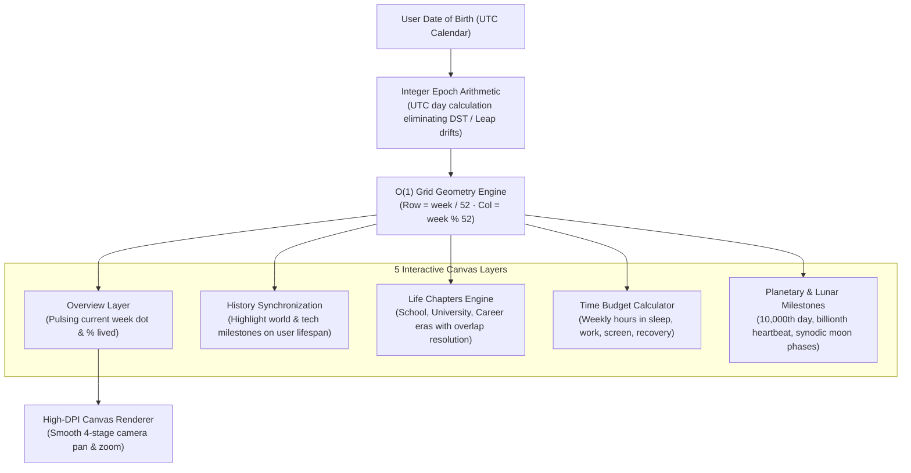

# Your Life in Dots — Lifespan in Weeks Visualizer & Temporal Geometry

> **Live Application:** [lifeindots.vercel.app](https://lifeindots.vercel.app/)  
> **Autonomous Interactive Reel:** [lifeindots.vercel.app/?demo=1](https://lifeindots.vercel.app/?demo=1)  
> **In-Browser Test Suite:** [lifeindots.vercel.app/?test=1](https://lifeindots.vercel.app/?test=1)  
> **Author:** [B Pradeep](https://github.com/Pradeep-B28) · [Portfolio](https://pradeep-b28.github.io/Pradeep-B28/)

---

## Overview

**Your Life in Dots** renders an entire human lifespan as an interactive, geometric grid of weeks—52 columns wide (one per week of a year) across 70, 80, 90, or 100 rows. It gives users immediate perspective on the proportion of life lived, recurring life chapters, and the number of Sundays ahead.

Engineered with zero third-party libraries using pure HTML5 Canvas, modern CSS variables, and Vanilla JavaScript (ES modules).



---

## Mathematical Foundations & Precision

| Domain | Mathematical Implementation |
| :--- | :--- |
| **Integer UTC Day Calculation** | Dates are converted to integer days elapsed since `January 1, 1970 00:00:00 UTC`, completely preventing daylight saving shifts, leap second anomalies, and client timezone distortions. |
| **Constant-Time $O(1)$ Grid Indexing** | With 52 columns per row, dot positions are calculated via direct arithmetic division and modulus: `row = Math.floor(week / 52)` and `col = week % 52`, rather than querying thousands of DOM nodes. |
| **Synodic Lunar Phase Engine** | Full moon milestones leverage the high-precision astronomical synodic period ($T = 29.530588853\text{ days}$) calibrated against the reference astronomical full moon of January 13, 2025 at 22:27 UTC. |
| **Discretized Time Budgeting** | Daily time budget hours are converted into integer weeks using standard whole-number division, eliminating sub-pixel rendering artifacts and preserving exact week sums. |

---

## Strict Client-Side Privacy

- **Zero Tracking:** Date of birth, custom life chapters, and time budgets are processed strictly in volatile browser RAM.
- **No Cookies or Local Storage for PII:** Sensitive personal details are never saved to disk, cookies, or remote databases.
- **Zero Network Transmission:** All math, canvas rendering, and image generation occurs on your device.

---

## Local Development Setup

No compilation or build tools required.

1. **Clone the repository:**
   ```bash
   git clone https://github.com/Pradeep-B28/Life_In_Dots.git
   cd Life_In_Dots
   ```

2. **Serve with any local static HTTP server:**
   ```bash
   # Using Python 3
   python -m http.server 8000
   ```

3. **Open in browser:**
   ```
   http://localhost:8000/
   ```

---

## License

This project is licensed under the [MIT License](LICENSE).
